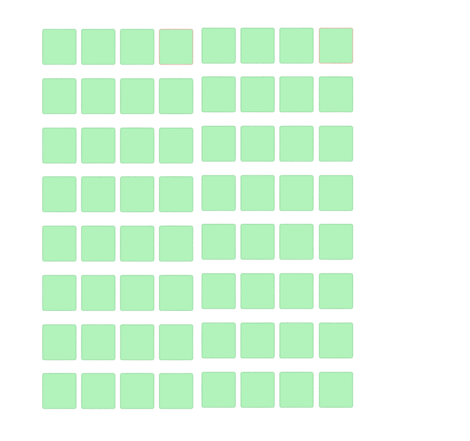
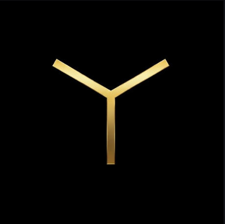

# Tertium Datur: Non-Square Geometries for Balanced Ternary FPGA Fabrics

**Tertium Datur** (from Latin *tertius*, third, and *dare*, to give or grant, answering the binary axiom *tertium non datur*) is a 3D (Three-Dimensional, volumetric spatial geometry) interactive visualizer built with Three.js over WebGL (Web Graphics Library, a browser programming interface for hardware-accelerated graphics). It explores non-orthogonal topologies designed specifically to represent balanced ternary logic (`{-1, 0, +1}`) on an FPGA (Field-Programmable Gate Array, a digital integrated circuit with reconfigurable logic blocks and interconnects).

---

## Etymology and Geometric Motivation

The word *geometry* derives from the Greek *ge* (earth) and *metron* (measure), while *orthogonal* originates from *orthos* (right, straight) and *gonia* (angle). Traditional square FPGA grids inherit a $90^\circ$ orthogonal metric that partitions the plane along powers of two ($2^2 = 4$ cardinal directions: North, South, East, West).

Balanced ternary architecture adopts an **isotropic** (from Greek *isos*, equal, and *tropos*, direction) three-axis symmetry based on $120^\circ$ ($360^\circ / 3$) angular separation. Merging an isotropic Y-junction with a **hexagon** (from Greek *hex*, six, and *gonia*, angle) eliminates binary spatial bias and reflects base-3 computation directly in silicon topology.

| Orthogonal Square FPGA Grid ($90^\circ$, $2^k$) | Isotropic Ternary Y-Junction ($120^\circ$, $3^k$) |
| :---: | :---: |
|  |  |

---

## Five Geometric Models for Balanced Ternary Logic

### 1. The Tripartite Hexagon (`1 Trit` / `T-CLB`)
Inscribing a $120^\circ$ Y-junction (with arms at $30^\circ$, $150^\circ$, and $270^\circ$) inside a pointy-top regular hexagon divides the cell into **three congruent rhombi** with internal angles of $60^\circ$ and $120^\circ$. Each rhombus forms a physical sector inside a CLB (Configurable Logic Block, a programmable logic tile that executes combinational operations and state storage):

* **Top rhombus ($30^\circ$ to $150^\circ$):** Neutral state `0` ($0\text{ V}$ center reference).
* **Left rhombus ($150^\circ$ to $270^\circ$):** Negative state `-1`.
* **Right rhombus ($270^\circ$ to $30^\circ$):** Positive state `+1`.

### 2. Vertex-Face Duality: Honeycomb Tiles and Y-Switchboxes
In a continuous hexagonal tessellation, every junction shared by three adjacent hexagonal tiles forms an exact $120^\circ$ Y-vertex:
* Hexagons serve as ternary CLBs with three opposite face axes separated by $120^\circ$.
* Triple vertices between tiles serve as three-way routing switchboxes, matching the three inputs of a ternary full adder (`A`, `B`, `C_in`) and three-way branching instructions (`BCEG`: less, equal, greater).

### 3. Zero-Sum Cubic Coordinates ($q + r + s = 0$)
Hexagonal fabrics replace Cartesian $(x, y)$ pairs with three coplanar coordinates $(q, r, s)$ governed by the invariant:

$$q + r + s = 0$$

Every neighbor step adds `+1` along one axis, `-1` along a second axis, and keeps `0` on the third axis, expressing physical tile addressing directly in balanced ternary digits.

### 4. Hexagonal Rosettes (`Tryte6` and `Word21`)
* **`Tryte6` Rosette (7 cells):** One central tile (arithmetic carry, parity, or local router) surrounded by 6 peripheral data trits ($3^6 = 729$ states covering $[-364, +364]$).
* **`Word21` Super-Cluster (21 cells):** Three 7-cell rosettes symmetrically arranged at $120^\circ$ around an empty origin cavity housing a macro Y-bus, totaling $3 \times 7 = 21$ tiles ($3^{21} = 10,460,353,203$ symmetric states).

### 5. Barycentric $3^k$ Subdivision for Ternary LUTs
Dividing a triangle or hexagonal sector from its barycenter via a Y-junction yields three equal-area sub-cells. Applying three recursive Y-subdivisions generates $3 \to 9 \to 27$ nested geometric cells, matching the 27 truth-table entries of a 3-input ternary LUT (Look-Up Table, a small memory array that implements combinational logic functions) stored in ternary SRAM (Static Random-Access Memory, volatile memory cells used to retain circuit configuration).

---

## Dynamic Switching Telemetry ($\Delta V^2$)

The interactive 3D visualizer tracks physical capacitive switching energy across transitions:
* **Half-swing (`0 <-> +1` or `0 <-> -1`):** Voltage change $\Delta V = V_{DD} / 2$, dissipating $0.25\,V_{DD}^2$.
* **Full-swing (`-1 <-> +1`):** Voltage change $\Delta V = V_{DD}$, dissipating $1.00\,V_{DD}^2$.
* **Traditional binary tile (`0 <-> 1`):** Every transition incurs $1.00\,V_{DD}^2$.

---

## Interactive Three.js Modes

The scene controller in [`src/scene.js`](src/scene.js) and the DOM (Document Object Model, the in-memory tree representation of browser elements) bindings in [`src/ui.js`](src/ui.js) expose four interactive views:

1. **`1 Trit Y-Hex`**: Single tripartite hexagon with clickable sectors and live $\Delta V^2$ pulse rings.
2. **`Tryte6 Rosette (7)`**: Seven-tile axial cluster with inter-tile golden Y-routing nodes at triple vertices.
3. **`Word21 Fabric (21)`**: Complete 21-trit word cluster formed by three 7-cell rosettes around a central Y-bus.
4. **`90° Square vs 120° Hex-Y`**: Side-by-side geometric and energetic comparison against a $4 \times 4$ orthogonal binary grid.

See [`docs/geometry.md`](docs/geometry.md) for the complete mathematical derivations of all mesh vertices, axial projections, and disjointness proofs.

---

## Quick Start with Bun

```sh
bun install
bun run dev
```

To generate the minified standalone bundle in `dist/bundle.js`:

```sh
bun run build
```

Licensed under the MIT (Massachusetts Institute of Technology, permissive open-source software license) License; see [`LICENSE`](LICENSE).
